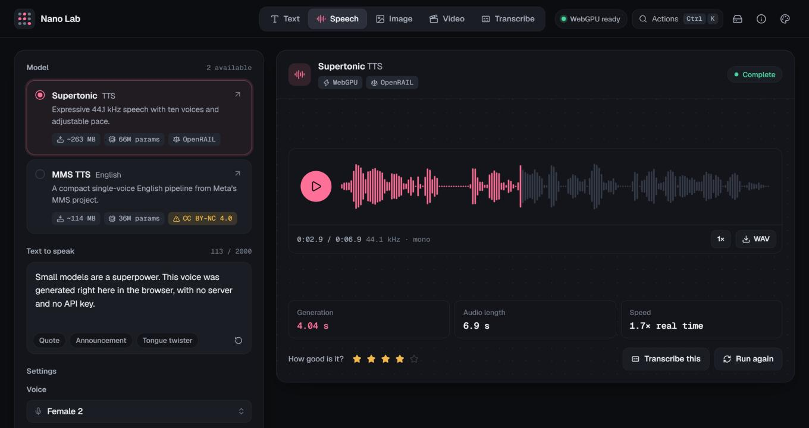

# Nano Lab

**Live at [nanolab.fyi](https://nanolab.fyi)** · [source on GitHub](https://github.com/afj176/nano-lab)

Nano Lab is a local-first playground for exploring the frontier of small generative models. Its vision is a single, approachable workspace where curious builders can run text, speech, transcription, image, and video models in the browser, compare the cost and speed of real runs, and judge output quality for themselves. It is an experiment in making the tradeoffs behind on-device AI visible—not a claim that every modality is already tiny or equally mature.

## Run locally

Requires Node.js and npm. Install dependencies with `npm install`, then run `npm run dev` and open the URL printed in the terminal. Use a current Chromium-based browser with hardware acceleration enabled. The app downloads model weights on first use; these downloads can be substantial.

## What works today

- **Text:** SmolLM2 135M and 360M instruction models (Apache-2.0; about 182 MB and 388 MB) through Transformers.js, streamed token by token with a stop button, adjustable length and temperature. WebGPU is used when available; otherwise the app attempts WASM, and you can force CPU from the settings.
- **Speech:** Supertonic TTS (OpenRAIL; about 263 MB; ten voices, quality steps, pace) and English MMS TTS (upstream weights are CC BY-NC 4.0) through Transformers.js, with a waveform player and WAV download.
- **Transcribe:** Moonshine Tiny (MIT, English, about 28 MB on CPU) and Whisper Base (Apache-2.0, multilingual with translate-to-English, about 77 MB on CPU) through Transformers.js. The WebGPU builds are larger (about 76 MB and 206 MB). Audio comes from the microphone, a dropped or chosen file, or the “Transcribe this” button on a speech result; it is resampled to 16 kHz mono in the browser. Whisper detects the spoken language from the first 30 seconds by default (the app reads the language token the model emits, since the library does not do this itself); you can also pick the language by hand.
- **Image:** [NanoDiffuser](https://huggingface.co/utkucoban/NanoDiffuser) is a one-step, quantized browser image pipeline with approximately 400 MB of model assets. It uses WebGPU with shader-f16 to produce 512×512 PNGs, with an optional fixed seed for repeatable runs. Its model weights retain OpenRAIL++ terms; review the model card before use.
- **Video:** Drishya Tiny generates short neural video clips directly in the browser. By default NanoDiffuser paints the opening frame from the same prompt and seed and Drishya animates it (image-to-video), which gives much sharper clips than text alone; this needs shader-f16, adds the ~400 MB image model, and puts the clip under NanoDiffuser's OpenRAIL++ terms as well. “From text only” skips the image model. See the model and licensing notes below.

## Comparing runs

Successful in-app runs are stored in local browser storage, together with the prompt, settings and backend, so a past setup can be restored from the run list. The Runs section filters by modality, sorts by recency, speed or rating, charts average generation time per model, and exports JSON. Generation time excludes downloads. Image time includes session setup; video time excludes it; sizes are approximate model download estimates, not measured memory usage. Rate quality manually from one to five stars. Compare similar prompts, devices, settings, and cold/warm load conditions when drawing conclusions. Outputs themselves are not persisted in run history, apart from a small thumbnail for images.

The app downloads code and model files from package and model hosts. Inference for the integrated models runs in the browser; the video pipeline runs locally as well. Browser caches can be evicted, storage is finite, and a model that works on one GPU may fail on another. A service worker caches the app shell and the CDN-hosted runtimes after the first visit, so once a model has been downloaded the app can be reopened and used offline. The Storage panel in the header shows how much each group of models occupies, deletes downloads, and releases loaded models from memory.

## Development

`npm run build` creates the production bundle in `dist/`. Text and speech use `@huggingface/transformers`; the SD Turbo pipeline uses `onnxruntime-web`. The model registry (sizes, licenses, per-model controls) is `src/models.js`. All inference runs in a background worker, `src/worker.js`, so the interface stays responsive; `src/runners.js` is the page-side client. Any run can be stopped: text stops after the current token and keeps what it wrote, everything else stops immediately by shutting the worker down, which also unloads the models. state and persistence are in `src/store.js`. The interface is dependency-free vanilla JS: `src/ui/components.js` holds the custom controls (segmented control, slider, select, seed input, rating, popover, dialog, command palette, toasts), `src/ui/players.js` the output players, and `src/ui/app.js` the layout. Design tokens for the light and dark themes and the six accents are at the top of `src/style.css`. Image inference is in `src/image.js`.

Keyboard: Ctrl/⌘ K opens the command palette, Ctrl/⌘ Enter runs, `/` focuses the prompt.

`npm test` runs the unit tests (model registry integrity and formatting helpers) with Vitest. Fonts are bundled with the app; the only third-party hosts contacted are Hugging Face (model weights) and jsDelivr (ONNX Runtime files for the image and video pipelines).

## Deploying to GitHub Pages

The site is deployed at [nanolab.fyi](https://nanolab.fyi), a custom domain set in the repository's Pages settings (DNS: four A records for the apex pointing at GitHub Pages, and a `www` CNAME to `afj176.github.io`). The site is fully static. `vite.config.js` uses relative asset paths, so the same build works from `username.github.io/repo/` or a domain root.

1. Create a GitHub repository and push this folder to its `main` branch.
2. In the repository, open Settings → Pages and set Source to "GitHub Actions".
3. Every push to `main` then runs `.github/workflows/deploy.yml`, which installs, tests, builds and publishes `dist/`.

GitHub Pages serves over HTTPS, which the microphone and the service worker both require. It cannot send the cross-origin isolation headers that multi-threaded WASM needs, so CPU fallbacks run single-threaded there.

Before publishing, check the About & licenses panel: Drishya Tiny and MMS TTS are noncommercial (CC BY-NC 4.0).

Future work: cold and warm load-time measurements, persisted output artifacts, repeatable evaluation sets.

## Drishya Tiny video generation

The playground runs [Drishya Tiny by Udgam Labs](https://huggingface.co/udgamlabs/Drishya-Tiny), licensed under [CC BY-NC 4.0](https://creativecommons.org/licenses/by-nc/4.0/), for noncommercial research and personal experimentation. The browser code is Apache-2.0; see `DRISHYA-LICENSE`. It downloads approximately 665 MB for the text encoder, generator, and decoder. The generator has 212M parameters; the full pipeline includes other models. It produces 17 frames at 256×256, displayed as an approximately two-second WebM with an AI-generated mark. The model works best on nature scenes, and its authors report weak prompt following and poor people and text. The browser runtime uses WebGPU when available and may fall back to significantly slower WASM. Output generation defaults to 25 steps, guidance 5 and seed 42; all are adjustable. With a generated first frame, the reported generation time includes painting that frame. Model downloads and WebM encoding are excluded from the generation time.

## License

The app's own code is MIT licensed; see `LICENSE`. `src/drishya-web.js` is the Drishya browser runtime under Apache-2.0; see `DRISHYA-LICENSE`. Model weights are not part of this repository and each carries its own license, listed in the About & licenses panel.
